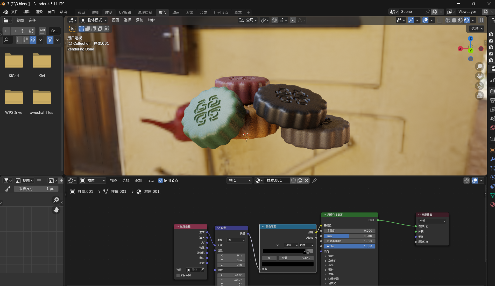
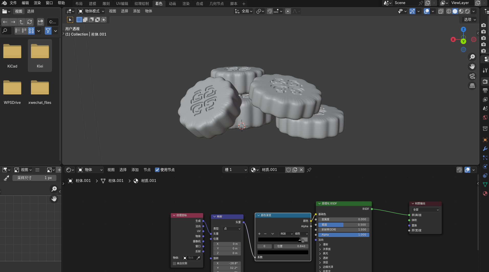
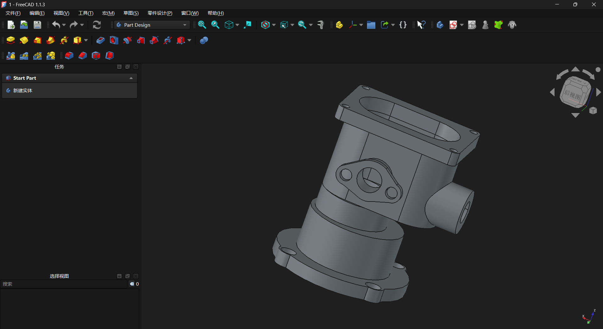
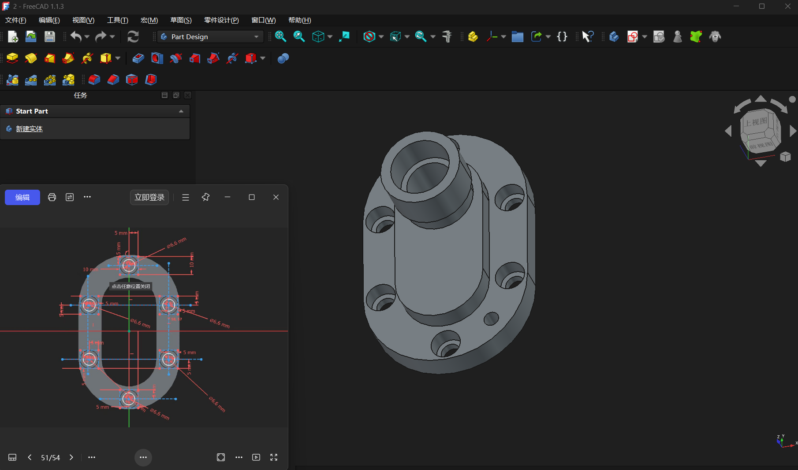
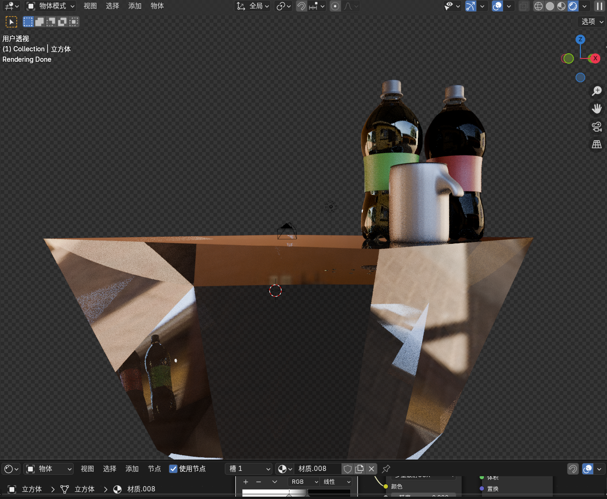
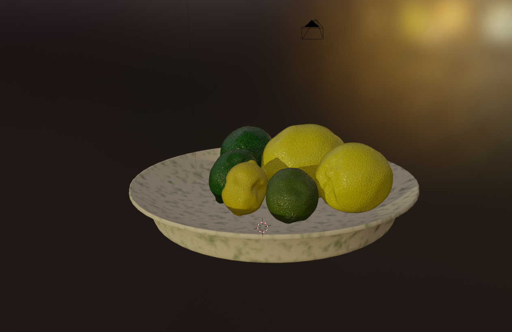

今天是2026年9月25日，农历八月十五，中秋节。我用3D建模制作了一个中秋节主题的小作品，个人觉得还算满意。借此机会，祝全国乃至全世界的朋友们中秋快乐，月圆人团圆！

-----------------
***CAD**

**以下是我通过，FreeCAD1.1做成的工科草图和以及最后完成的模型**

-------------------

————————***建模**

***这是我用BIender4.5学习并创造出来的***

